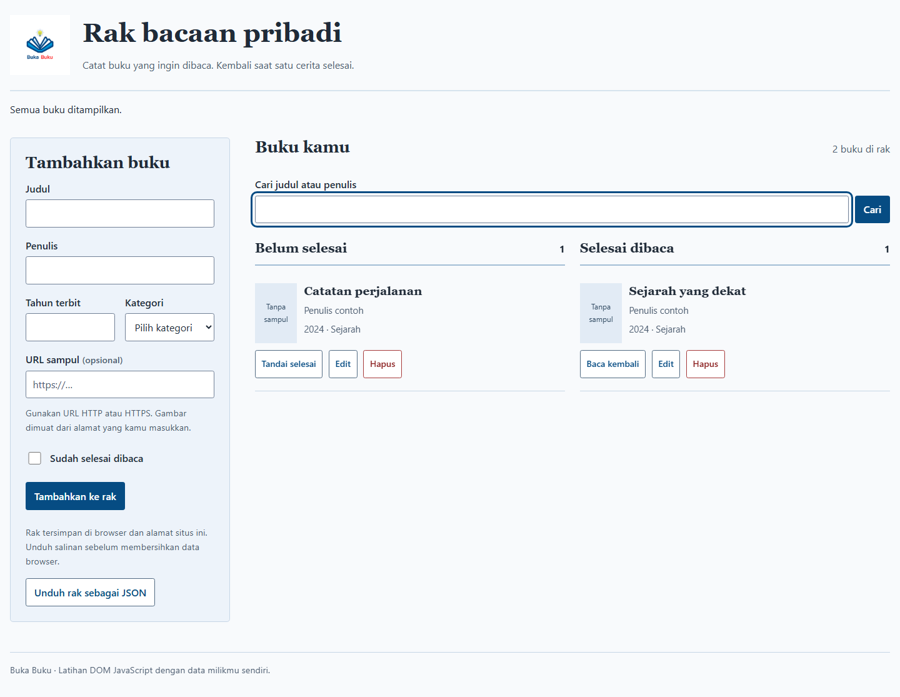

# Buka Buku: rak bacaan pribadi

Aplikasi HTML, CSS, dan JavaScript untuk mencatat buku, mencari judul atau penulis, serta memindahkan buku antara rak belum selesai dan selesai dibaca. Data disimpan di `localStorage` browser. Aplikasi dapat berjalan tanpa akun, backend, atau database.



Screenshot berasal dari aplikasi yang dijalankan di Chrome. Dua buku merupakan data contoh pengujian yang dimasukkan lewat formulir, bukan data bawaan aplikasi. [Lihat tampilan ponsel](docs/images/bookshelf-mobile.png).

## Jalankan lokal

Gunakan Python 3 dan browser modern:

```powershell
git clone https://github.com/zalamanga/bookshelf-dom.git
Set-Location -LiteralPath '.\bookshelf-dom'
python -m http.server 8080 --bind 127.0.0.1
```

Buka [http://127.0.0.1:8080](http://127.0.0.1:8080). Hentikan server dengan `Ctrl+C`. Node.js hanya diperlukan untuk menjalankan tes. Gunakan server localhost atau hosting HTTPS agar ES modules dan `crypto.randomUUID()` tersedia.

## Menggunakan rak

1. Isi judul, penulis, tahun terbit, dan kategori. URL sampul boleh dikosongkan.
2. Pilih status bacaan, lalu tekan **Tambahkan ke rak**.
3. Gunakan **Tandai selesai** atau **Baca kembali** untuk memindahkan buku. **Edit** mengubah buku yang sama; **Batal edit** membatalkan perubahan formulir.
4. Cari judul atau penulis dengan tombol **Cari** atau Enter. **Hapus pencarian** menampilkan seluruh rak kembali.
5. **Hapus** meminta konfirmasi sebelum mengeluarkan buku. Escape atau **Batal** mempertahankan buku.
6. **Unduh rak sebagai JSON** menyimpan salinan isi rak saat ini.

Sampul HTTP/HTTPS dimuat langsung dari URL yang dimasukkan. Gambar yang gagal dimuat diganti dengan teks. URL dengan kredensial, `javascript:`, `data:`, dan `file:` ditolak.

## Penyimpanan dan pemulihan

Key `BOOKSHELF` mempertahankan format array dari proyek awal. ID angka dan tahun dalam bentuk string dari data lama dibaca kembali; kategori lama `Komedia` dinormalisasi menjadi `Komedi`.

```json
[
  {
    "id": "example-book",
    "title": "Judul contoh",
    "author": "Penulis contoh",
    "year": 2024,
    "category": "Sejarah",
    "image": "",
    "isComplete": false
  }
]
```

Data berlaku untuk browser, profil, alamat, dan port yang sama. Menghapus data browser juga menghapus rak. Berkas JSON merupakan arsip yang dapat dibaca; impor JSON belum tersedia pada antarmuka.

| Keadaan | Perilaku aplikasi |
| --- | --- |
| JSON rusak atau catatan tidak valid | Data asli tetap utuh. Rak baru berjalan sementara. **Unduh data asli** mengambil salinan persis sebelum **Ganti data rusak** menggantinya dengan konfirmasi. |
| Penyimpanan diblokir atau penuh | Perubahan tetap tampil dalam memori halaman, dengan pemberitahuan dan pilihan unduh atau coba simpan lagi. |
| Data berubah dari tab lain | Aplikasi menolak menimpa data tersebut. Unduh rak sementara, lalu **Muat data tersimpan** jika ingin mengambil versi browser. |

Rak dibatasi 1.000 buku dan dua juta karakter JSON agar data yang disimpan tetap dapat dibaca oleh pemeriksaan saat muat ulang. Judul maksimal 200 karakter, penulis 160, tahun bulat 1–9999, dan URL sampul 2.048 karakter. Aplikasi tidak menyinkronkan data antarperangkat.

## Alur kode

[Diagram dan penjelasan alur](docs/CODE_FLOW.md) menjelaskan validasi, perubahan rak, penyimpanan, konflik antartab, dan pemulihan.

| Berkas | Tanggung jawab |
| --- | --- |
| `index.html` | Formulir, pencarian, dua rak, dan dialog konfirmasi |
| `src/script/books.js` | Validasi buku, migrasi format lama, pencarian, dan penyimpanan |
| `src/script/app.js` | Peristiwa DOM, rendering aman, fokus, unduhan, dan pesan pengguna |
| `src/style/style.css` | Tata letak responsif dan keadaan fokus |
| `tests/` | Tes logika dan alur browser |

## Pengujian

Dengan Node.js 22 atau lebih baru, jalankan tes logika tanpa memasang dependency:

```powershell
npm test
```

Untuk tes browser:

```powershell
npm ci
npx playwright install chromium
npm run test:browser
```

Runner menyediakan server sementara pada loopback dan menutup browser/server setelah selesai. Tes memakai profil browser terpisah. Hasil validasi: 14 tes logika dan 9 skenario browser lulus, termasuk CRUD, teks HTML sebagai data, penyimpanan rusak/diblokir, konflik antartab, unduhan, keyboard, lima lebar layar, serta ukuran teks 200%.

Asal source dan aset dicatat dalam [NOTICE.md](NOTICE.md).
