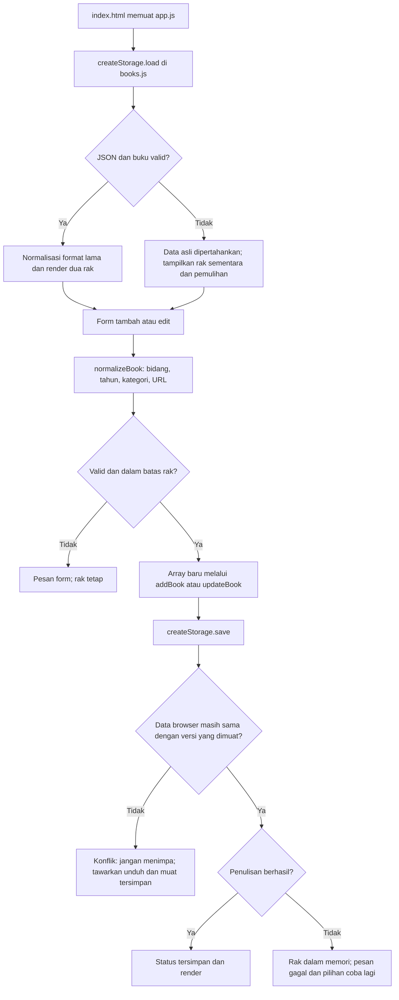

# Alur kode Buka Buku

`src/script/books.js` menangani data tanpa mengakses DOM. `normalizeBook()` menghasilkan objek baru dengan bidang yang digunakan aplikasi. `parseBooks()` memeriksa seluruh array, termasuk ID berulang; satu catatan rusak tidak dibuang diam-diam. `addBook()` dan `updateBook()` memeriksa batas ukuran sebelum mengganti array yang aktif.

`src/script/app.js` merangkai objek DOM dengan `createElement()` dan `textContent`. Judul, penulis, hasil pencarian, dan isi dialog tidak ditafsirkan sebagai HTML. Sampul memiliki validasi protokol dan fallback ketika gagal dimuat.

Pencarian melalui `matchingBooks()` membaca judul dan penulis tanpa mengubah data. Tombol status memanggil `updateBook()`, sedangkan hapus baru memfilter array setelah dialog dikonfirmasi. Form edit memakai ID yang sama; tombol batal hanya mereset formulir.

`createStorage()` menyimpan teks JSON yang terakhir dimuat sebagai versi pembanding. Sebelum menulis, fungsi membandingkan nilai browser dengan versi tersebut. Perbedaan menghasilkan status `conflict`, tanpa mengganti data browser. Peristiwa `storage` juga memunculkan pemberitahuan saat tab lain mengubah key.

Ketika data awal rusak, penulisan diblokir. **Unduh data asli** mengambil teks asli; **Ganti data rusak** meminta konfirmasi dan melakukan penulisan eksplisit. Ketika browser menolak penyimpanan, rak tetap dapat digunakan dalam memori halaman. Status berhasil baru tampil setelah `setItem()` selesai tanpa kesalahan.

`tests/books.test.js` memeriksa aturan data dan kegagalan storage dengan penyimpanan terisolasi. `tests/browser.mjs` menjalankan aplikasi melalui HTTP dan menguji tindakan pengguna pada Chrome/Chromium, termasuk pemulihan dan ukuran layar.

Buka source: [logika buku](../src/script/books.js), [penghubung DOM](../src/script/app.js), [halaman](../index.html), [tes logika](../tests/books.test.js), dan [tes browser](../tests/browser.mjs).
